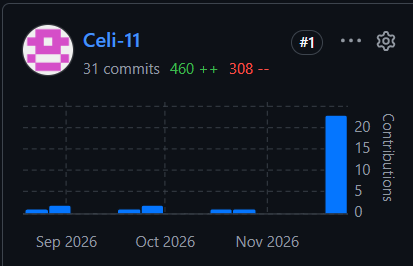

# Metodos_estadisticos :mushroom:
## Licenciatura En_Ingenieria Forestal :evergreen_tree:

Repositorio del curso de Métodos Estadísticos correspondiente al semestre agosto 2026 del programa de Ingenieria Forestal

Alumno: Celina Yazmín Puente Uribe

Matrícula: 2274723

## Contenido del Semestre 
🎯 Semana 2-Inicio del Semestre
- Preparar area de trabajo
- Crear cuenta de GitHub

🎯 Semana 3-Importación de datos

Fecha 19/09/2026

Actividades realizadas durante el curso

-Operaciones y gastos: aplicación de cálculos matemáticos, trabajo con vectores y creación de gráficas de barras.

-Estadística descriptiva: obtención de medidas estadísticas como el promedio, la varianza y la desviación estándar.

-Correlación y regresión lineal: estudio de la relación entre diferentes variables y construcción de modelos matemáticos.

-Importación de datos: ingreso de información desde archivos CSV y organización de bases de datos.

-Representación gráfica de datos: creación de diagramas de caja (boxplots) y comparación de distintos tratamientos.

-Análisis de correlaciones: estudio de la relación entre variables ambientales mediante gráficas de dispersión.

-Análisis de anillos de crecimiento: comparación de mediciones de crecimiento utilizando herramientas y pruebas estadísticas.

## Organización del repositorio

El repositorio está organizado en 3 carpetas principales.

Laboratorios: Contiene los archivos PDF de las prácticas y laboratorios realizados durante el curso.

Scripts: Contiene los códigos y ejercicios desarrollados en R.

Tareas: Contiene los trabajos y actividades correspondientes a la materia.

## Gráfica de contribuciones

A continuación se muestra la gráfica de contribuciones realizadas durante el desarrollo del repositorio.

